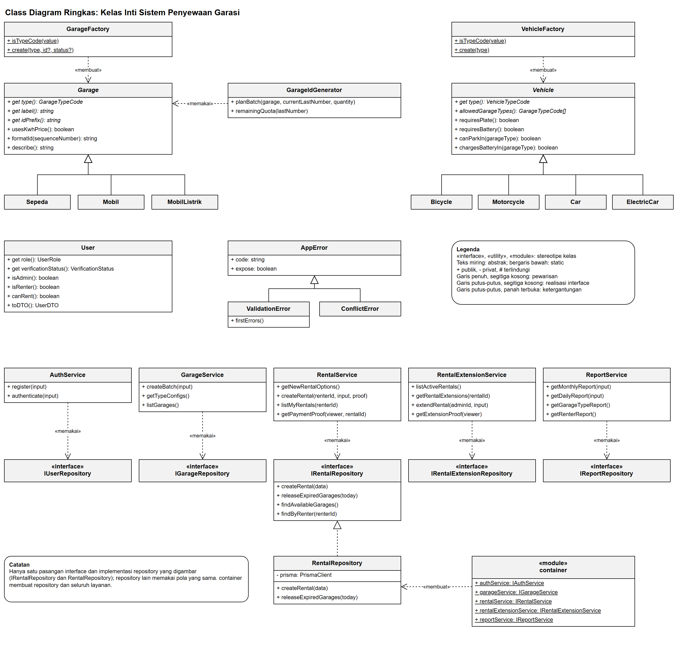
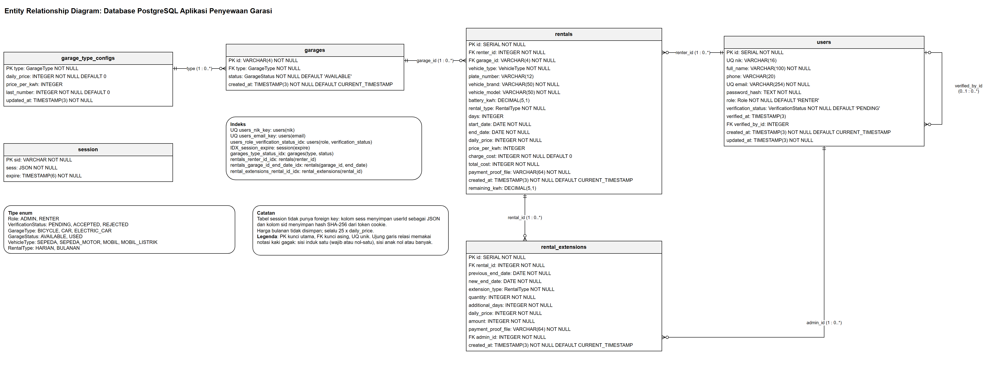
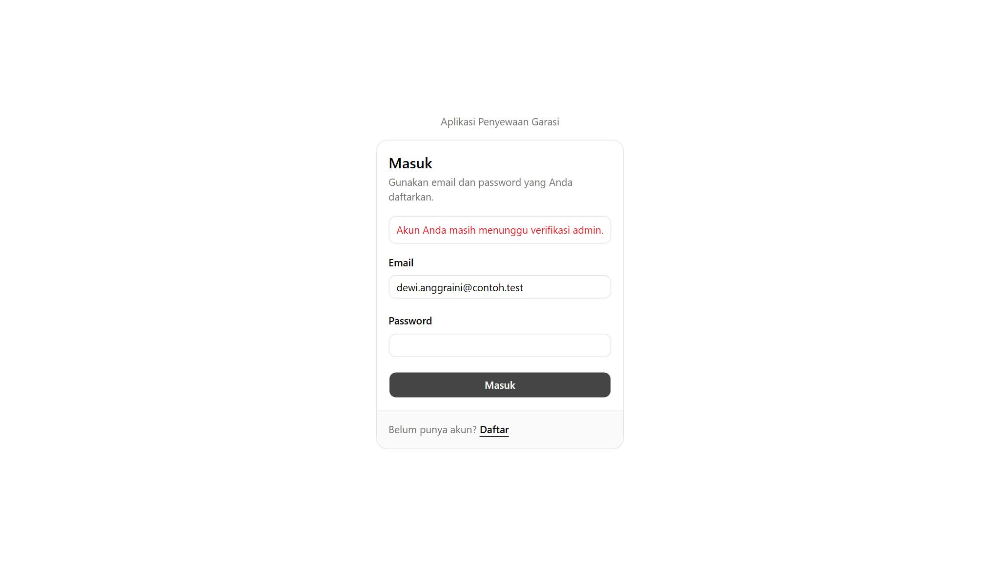
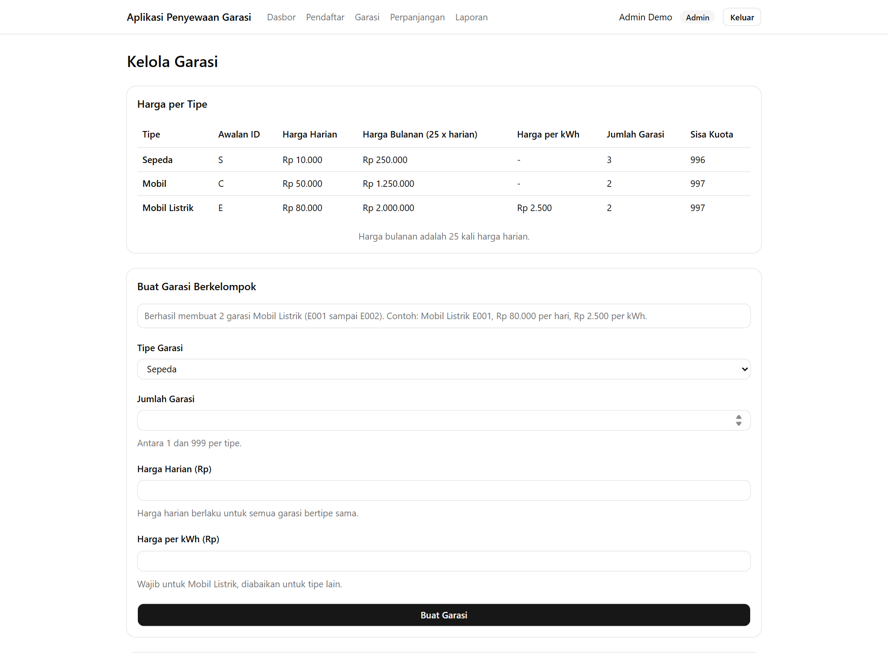
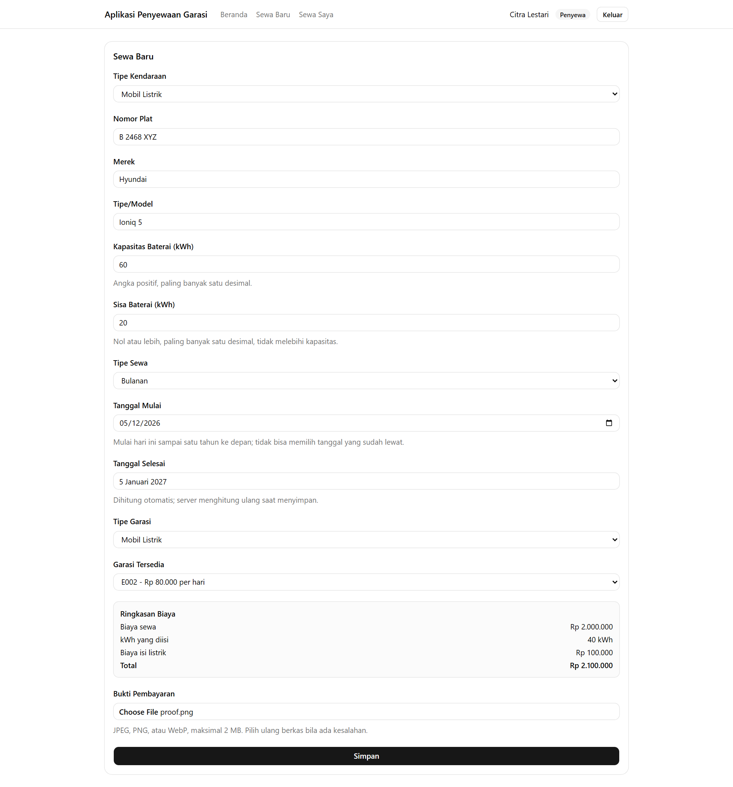
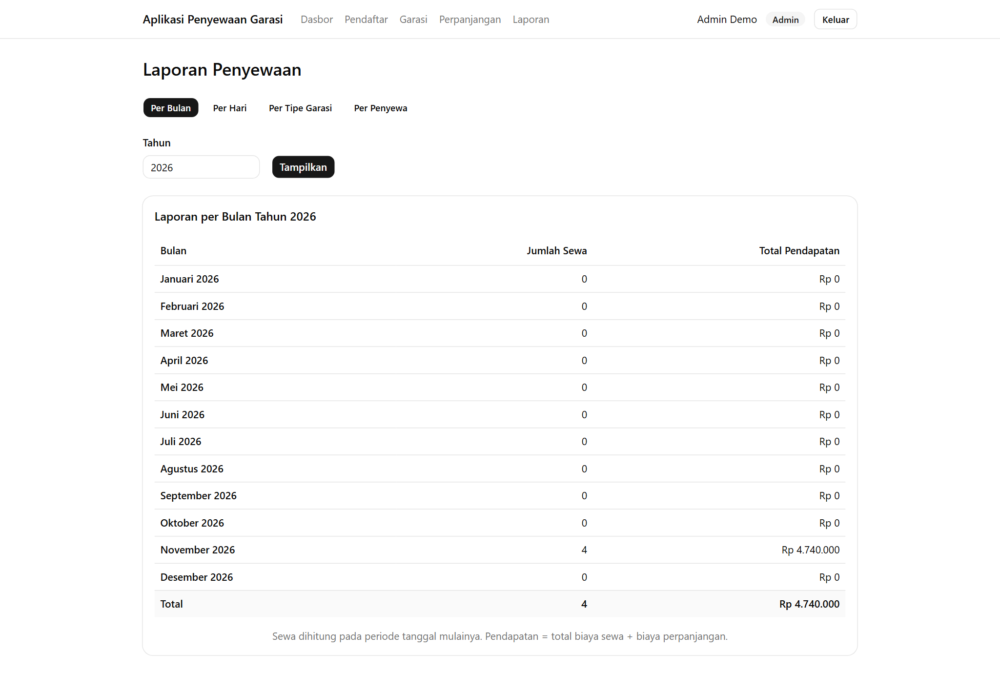
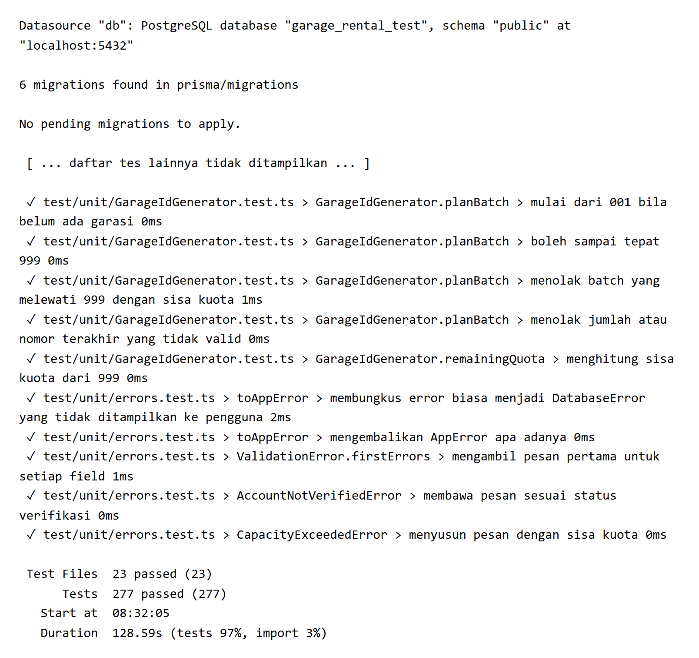

# LAPORAN UJI KOMPETENSI

**Skema Sertifikasi: Pemrogram**

Proyek Singkat: Aplikasi Penyewaan Garasi Kendaraan

Nama Asesi : Kenley Jonathan
NIM : 0706012310030
Program Studi : Informatika, Universitas Ciputra
Nama Asesor : Citra Lestari
Tanggal : 22 November 2026

## 1. Use Case Diagram

Use case diagram memuat tiga aktor (Pengguna, Penyewa, dan Admin) dan 25 use case. Penyewa dan Admin adalah turunan aktor Pengguna sehingga keduanya memakai Login dan Logout.

Tabel berikut menjelaskan use case utama pada diagram.

| Use Case | Aktor | Penjelasan |
| --- | --- | --- |
| Registrasi Akun | Penyewa | Calon penyewa mengisi NIK, nama lengkap, nomor telepon, email, dan password. Akun baru berstatus Menunggu verifikasi. |
| Login | Penyewa, Admin | Pengguna masuk dengan email dan password. Akun yang belum diterima Admin ditolak dengan pesan yang jelas. |
| Logout | Penyewa, Admin | Pengguna keluar dari aplikasi. |
| Buat Sewa Baru | Penyewa | Penyewa yang sudah diterima memilih sewa harian atau bulanan. Use case ini mencakup Isi Detail Kendaraan, Pilih Garasi Tersedia, Hitung Total Biaya, dan Unggah Bukti Pelunasan. |
| Lihat Sewa Saya | Penyewa | Penyewa melihat daftar sewanya beserta tanggal mulai dan berakhir, biaya, status, dan tautan bukti pembayaran. |
| Verifikasi Pendaftar | Admin | Admin melihat pendaftar berstatus menunggu, lalu menerima (setelah mencentang validasi KTP) atau menolak. |
| Atur Harga Garasi | Admin | Admin mengatur harga per tipe garasi. Harga ini dipakai saat garasi dibuat. |
| Buat Garasi Massal | Admin | Admin membuat beberapa garasi sekaligus untuk satu tipe. ID dibuat otomatis berurutan (S001, C001, E001, dan seterusnya). |
| Lihat Daftar Garasi | Admin | Admin melihat semua garasi beserta tipe, harga, dan status tersedia atau terpakai. |
| Perpanjang Sewa (Harian atau Bulanan) | Admin | Admin memperpanjang sewa yang sedang berlaku. Use case ini mencakup Lihat Daftar Sewa Aktif, Hitung Sisa Biaya, dan Unggah Bukti Pembayaran Perpanjangan. |
| Lihat Riwayat Perpanjangan | Admin | Admin melihat riwayat perpanjangan sebuah sewa. |
| Lihat Laporan Sewa | Admin | Admin melihat laporan per bulan, per hari, per tipe garasi, dan per penyewa. |

## 2. Class Diagram

Alur permintaan dalam aplikasi: halaman atau Server Action memanggil service, service memanggil repository, dan repository mengakses database PostgreSQL lewat Prisma. Aturan bisnis ada di lapisan domain yang murni tanpa akses database, dan `src/lib/container.ts` merakit objek serta menyuntikkan ketergantungan. Aplikasi memakai arsitektur berlapis (layered) yang mengikuti pola MVC: View berupa halaman React, Controller berupa Server Action, dan Model terdiri atas service, domain, dan repository yang dihubungkan dengan dependency injection.

| Peran MVC | Padanan di aplikasi |
| --- | --- |
| View | Halaman dan komponen React (`src/app`, `src/components`) |
| Controller | Server Action (`actions.ts`) dan Route Handler, yang memeriksa peran, membaca form, memanggil service, lalu mengarahkan ulang atau mengembalikan pesan galat |
| Model | Service (alur kerja), domain (aturan dan objek murni), dan repository (akses database lewat Prisma) |

Class diagram ringkas pada gambar berikut memuat kelas inti aplikasi; versi lengkap lima halaman ada di `docs/diagram/class-diagram.drawio`.

| Kelas | Fungsi |
| --- | --- |
| `Garage` (abstrak), `Sepeda`, `Mobil`, `MobilListrik` | `Garage` menyimpan ID dan status garasi serta membentuk ID (`formatId`). Subkelas menimpa tipe, label, dan awalan ID (S, C, E); `MobilListrik` juga memakai harga per kWh. |
| `Vehicle` (abstrak), `Bicycle`, `Motorcycle`, `Car`, `ElectricCar` | Menentukan tipe garasi yang boleh dipakai (`canParkIn`), apakah plat nomor dan baterai wajib, dan apakah ada biaya pengisian (`chargesBatteryIn`). |
| `GarageFactory`, `VehicleFactory` | Membuat objek garasi atau kendaraan dari kode tipe (`create`). |
| `GarageIdGenerator` | Menyusun ID berurutan untuk satu batch (`planBatch`) dan menolak batch yang melewati 999 garasi per tipe. |
| `User` | Menyimpan data pengguna, peran, dan status verifikasi (`canRent`, `isAdmin`). `toDTO` menghasilkan objek polos tanpa hash password. |
| `AppError`, `ValidationError`, `ConflictError` | `AppError` adalah induk semua error aplikasi (membawa `code` dan `expose`). `ValidationError` membawa pesan per field; `ConflictError` dipakai saat data sudah berubah. Turunan lain: `DuplicateUserError`, `AuthenticationError`, `AccountNotVerifiedError`, `ForbiddenError`, `NotFoundError`, `CapacityExceededError`, dan `DatabaseError`. |
| `AuthService`, `GarageService` | `AuthService` mendaftarkan penyewa (`register`) dan memeriksa login (`authenticate`). `GarageService` mengatur harga dan membuat garasi berkelompok (`createBatch`) serta menampilkan daftar garasi. |
| `RentalService`, `RentalExtensionService` | `RentalService` membuat sewa (`createRental`) dan menampilkan sewa milik penyewa. `RentalExtensionService` memperpanjang sewa oleh Admin (`extendRental`) dan menampilkan riwayatnya. |
| `ReportService` | Menyusun laporan penyewaan per bulan, per hari, per tipe garasi, dan per penyewa. `VerificationService` (tidak digambar) menerima atau menolak pendaftar dengan pola yang sama. |
| `IUserRepository`, `IGarageRepository`, `IRentalRepository`, `IRentalExtensionRepository`, `IReportRepository`, `RentalRepository` | Interface repository menentukan operasi database yang dibutuhkan service sehingga service tidak bergantung pada database. `RentalRepository` mengimplementasikan `IRentalRepository` lewat Prisma (`createRental`, `releaseExpiredGarages`, `findAvailableGarages`, `findByRenter`); repository lain memakai pola yang sama. |
| `container` | Merakit repository dan service lalu menyerahkannya ke halaman dan Server Action. |
| Modul aturan sewa (`pricing`, `rentalPeriod`, `rentalCost`, `paymentProof`, `rentalExtension`, `rentalReport`) | Fungsi murni untuk harga bulanan, tanggal berakhir, biaya sewa dan pengisian, pengenalan jenis gambar bukti pembayaran, perpanjangan, dan pengelompokan laporan. |
| `BcryptPasswordHasher`, `LocalPaymentProofStorage` | Menghash dan memverifikasi password dengan bcrypt; menyimpan berkas bukti pembayaran di folder `uploads/bukti-pembayaran` di luar folder publik. |

Penerapan konsep pemrograman berorientasi objek pada kode:

| Konsep | Penerapan |
| --- | --- |
| Inheritance | `Sepeda`, `Mobil`, dan `MobilListrik` mewarisi `Garage`; `Bicycle`, `Motorcycle`, `Car`, dan `ElectricCar` mewarisi `Vehicle`. |
| Polymorphism | Getter `type`, `label`, dan `idPrefix` ditimpa tiap subkelas garasi; `MobilListrik` menimpa `usesKwhPrice`. `GarageFactory.create` mengembalikan objek `Garage` tanpa pemeriksaan `instanceof`. |
| Abstract class | `Garage` dan `Vehicle` tidak bisa dibuat langsung dan memaksa subkelas mengisi anggota abstraknya. |
| Encapsulation | Field privat `#id` dan `#status` pada `Garage`, `#props` pada `User`, dan parameter konstruktor `private readonly` pada service. |
| Interface | `IAuthService`, `IRentalService`, `IUserRepository`, `IRentalRepository`, `IPasswordHasher`, dan `IPaymentProofStorage`. |
| Factory | `GarageFactory.create` dan `VehicleFactory.create` membuat objek dari kode tipe. |
| Dependency injection | Service menerima repository, penyimpan bukti pembayaran, dan pengaman password lewat konstruktor; `container.ts` merakitnya. |
| Exception class | Semua error aplikasi mewarisi `AppError`; `ValidationError` membawa pesan per field. Fungsi `toAppError` membungkus error tak terduga menjadi `DatabaseError` dengan pesan umum. |
| Overloading metode | Metode `describe` pada `Garage` punya tiga tanda tangan: tanpa argumen, dengan harga harian, dan dengan harga harian serta harga per kWh. |

## 3. Entity Relationship Diagram

Database PostgreSQL memiliki enam tabel:

| Tabel | Isi |
| --- | --- |
| `users` | Akun Admin dan Penyewa: NIK, nama lengkap, telepon, email, hash password, peran, status verifikasi, serta waktu dan Admin yang memverifikasi. |
| `session` | Sesi login. Kolom `sid` berisi hash SHA-256 token cookie, `sess` berisi id pengguna, dan `expire` adalah waktu kedaluwarsa sesi. |
| `garage_type_configs` | Konfigurasi per tipe garasi: harga harian, harga per kWh (khusus mobil listrik), dan penghitung nomor ID terakhir (0 sampai 999). |
| `garages` | Satu baris per garasi: ID (misalnya S001, C010, E999), tipe, status tersedia atau terpakai, dan waktu dibuat. |
| `rentals` | Transaksi sewa: penyewa, garasi, data kendaraan, jenis sewa, jumlah hari, tanggal mulai dan berakhir, salinan harga, biaya pengisian, total biaya, dan nama berkas bukti pembayaran. |
| `rental_extensions` | Perpanjangan sewa: sewa yang diperpanjang, tanggal berakhir lama dan baru, jenis dan jumlah perpanjangan, tambahan hari, salinan harga harian, sisa biaya, nama berkas bukti pembayaran, dan Admin yang menyimpannya. |

Relasi antartabel:

| Relasi | Kardinalitas | Penjelasan |
| --- | --- | --- |
| `garage_type_configs` ke `garages` | Satu ke banyak | Satu tipe garasi memiliki banyak garasi (`garages.type`). |
| `garages` ke `rentals` | Satu ke banyak | Satu garasi dapat disewa berkali-kali pada waktu yang berbeda (`rentals.garage_id`). |
| `users` ke `rentals` | Satu ke banyak | Satu penyewa dapat memiliki banyak sewa (`rentals.renter_id`). |
| `rentals` ke `rental_extensions` | Satu ke banyak | Satu sewa dapat diperpanjang lebih dari sekali (`rental_extensions.rental_id`). |
| `users` ke `rental_extensions` | Satu ke banyak | Satu Admin dapat menyimpan banyak perpanjangan (`rental_extensions.admin_id`). |
| `users` ke `users` | Satu ke banyak | Satu Admin dapat memverifikasi banyak pendaftar; kolom `users.verified_by_id` boleh kosong. |

Tabel `session` tidak memiliki relasi kunci asing.

## 4. Library dan Komponen yang Digunakan

Versi library sesuai dengan `package.json`.

| Library / Komponen | Kegunaan dalam aplikasi |
| --- | --- |
| Next.js 16.4.6 | Kerangka web (App Router, Server Component, Server Action, Turbopack). |
| React 19.3.1 | Pustaka antarmuka untuk halaman dan formulir. |
| TypeScript 6.0.3 | Bahasa pemrograman dengan tipe, sehingga kesalahan tipe ketahuan sebelum aplikasi dijalankan. |
| Tailwind CSS 4.3.5 | Pengaturan tampilan dengan class utilitas. |
| shadcn 4.23.0 | Perkakas komponen shadcn/ui beserta gaya dasarnya. |
| @base-ui/react 1.9.0 | Komponen antarmuka dasar tanpa gaya yang menjadi fondasi komponen shadcn/ui (button, input, checkbox). |
| motion 14.14.0 (Framer Motion) | Animasi muncul pada halaman dan kartu. |
| lucide-react 1.77.0 | Ikon antarmuka. |
| PostgreSQL 17 | Database relasional untuk menyimpan semua data. |
| Prisma 7.10.1 (`prisma`, `@prisma/client`) | ORM: migrasi database, klien untuk query, dan seed akun Admin. |
| @prisma/adapter-pg 7.10.1 | Adapter driver PostgreSQL untuk klien Prisma. |
| Zod 4.6.7 | Validasi isian formulir dan pesan galat Bahasa Indonesia. |
| bcryptjs 3.0.3 | Menghash dan memverifikasi password. |
| Vitest 5.1.1 | Menjalankan unit test. |
| TypeDoc 0.28.20 | Membuat dokumentasi API dari komentar TSDoc. |
| dotenv 18.0.10 dan tsx 4.23.15 | Membaca berkas `.env` dan menjalankan seed TypeScript. |

## 5. Fitur Aplikasi

Tangkapan layar diambil dari aplikasi yang berjalan (`npm start`, lalu buka http://localhost:3000).

### 5.1 Masuk

Pengguna masuk dengan email dan password. Akun yang belum diterima Admin ditolak dengan pesan yang jelas.

### 5.2 Pendaftaran Penyewa

Calon penyewa mengisi NIK, nama lengkap, nomor telepon, email, dan password. Akun baru berstatus Menunggu verifikasi.

### 5.3 Verifikasi Pendaftar

Admin melihat pendaftar berstatus menunggu, lalu menerima (setelah mencentang validasi KTP) atau menolak.

### 5.4 Buat Garasi dan Daftar Garasi

Admin mengatur harga per tipe garasi, lalu membuat garasi secara berkelompok. ID dibuat otomatis berurutan (S001, C001, E001, dan seterusnya). Daftar semua garasi menampilkan tipe, harga harian, harga bulanan, harga per kWh (khusus mobil listrik), dan status.

### 5.5 Sewa Baru

Penyewa yang sudah diterima memilih sewa harian atau bulanan, mengisi data kendaraan, memilih tanggal mulai, memilih garasi yang tersedia, dan mengunggah bukti pembayaran. Tanggal mulai bawaannya hari ini (zona waktu Asia/Jakarta) dan dapat dipilih dari hari ini sampai satu tahun ke depan; tanggal yang sudah lewat ditolak. Tanggal selesai, batas jumlah hari sewa harian, dan ringkasan biaya mengikuti bulan tanggal mulai yang dipilih. Total biaya ditampilkan, termasuk biaya pengisian untuk mobil listrik di garasi mobil listrik.

### 5.6 Sewa Saya

Daftar sewa milik Penyewa beserta tanggal mulai dan berakhir, biaya, status, dan tautan bukti pembayaran.
 Total biaya sebuah sewa sudah termasuk semua perpanjangannya, dengan keterangan "termasuk perpanjangan" di bawah angkanya. Sewa yang tanggal mulainya belum tiba berstatus "Belum mulai". Perpanjangan ditampilkan sebagai daftar di bawah sewa yang bersangkutan, lengkap dengan jenis dan jumlahnya, tanggal selesai baru, biaya, dan tautan "Lihat bukti".

### 5.7 Perpanjang Sewa (Harian atau Bulanan)

Admin memperpanjang sewa yang sedang berlaku secara harian (jumlah hari) atau bulanan (jumlah bulan), mengunggah bukti pembayaran, dan melihat riwayat perpanjangan. Tanggal berakhir baru dan sisa biaya dihitung otomatis.

### 5.8 Laporan Sewa

Admin melihat laporan penyewaan dalam empat tampilan: per bulan (jumlah sewa dan jumlah uang untuk 12 bulan pada tahun yang dipilih), per hari (setiap tanggal pada bulan yang dipilih), per tipe garasi (sepeda, mobil, dan mobil listrik), dan per penyewa (setiap penyewa yang pernah menyewa).

## 6. Skenario Unit Testing

Unit test dibuat dengan Vitest dan dijalankan dengan perintah `npm test`. Hasil proses terakhir: 277 dari 277 tes lulus (23 berkas tes). Tes pada folder `test/unit` menguji fungsi dan kelas domain tanpa database, sedangkan tes pada folder `test/services` menguji layanan dengan database PostgreSQL terpisah yang namanya berakhiran `_test`. Tabel berikut memuat 31 skenario yang mewakili seluruh aturan bisnis; daftar 100 skenario terpilih ada di `docs/skenario-pengujian.md`.

| ID | Kelas / Method | Skenario | Input | Hasil yang Diharapkan | Hasil Aktual | Status |
| --- | --- | --- | --- | --- | --- | --- |
| UT-01 | `pricing.monthlyPrice` | Harga bulanan = 25 x harga harian | Harga harian 10000 dan 0 | Harga bulanan 250000 dan 0 | Sesuai | Lulus |
| UT-02 | `rentalCost.calculateRentalCost` | Biaya sewa harian | Harian, 3 hari, harga harian 10000, tanpa pengisian daya | Biaya sewa 30000, biaya pengisian 0, total 30000 | Sesuai | Lulus |
| UT-03 | `rentalCost.calculateRentalCost` | Biaya sewa bulanan | Bulanan, harga harian 50000 | Total 1250000 (25 x 50000) | Sesuai | Lulus |
| UT-04 | `rentalCost.calculateRentalCost` | Biaya pengisian mobil listrik bulanan | Bulanan, harga harian 80000, kapasitas 60 kWh, sisa 20 kWh, Rp 2500 per kWh | Biaya sewa 2000000, biaya pengisian 100000 (40 kWh x 2500), total 2100000 | Sesuai | Lulus |
| UT-05 | `RentalService.createRental` | Mobil listrik di garasi mobil biasa tanpa biaya pengisian | Mobil listrik di C001 (harga harian 50000), harian 1 hari, baterai 17,3, sisa 5,5 | Total 50000, biaya pengisian 0, harga per kWh kosong | Sesuai | Lulus |
| UT-06 | `Sepeda`, `Mobil`, `MobilListrik` (`Garage.formatId`) | Format ID garasi | Sepeda nomor 1, Mobil nomor 10, Mobil Listrik nomor 999 | S001, C010, E999 | Sesuai | Lulus |
| UT-07 | `GarageIdGenerator.planBatch` | Batch melanjutkan nomor terakhir | Sepeda, nomor terakhir 4, jumlah 2 | S005 dan S006 | Sesuai | Lulus |
| UT-08 | `GarageIdGenerator.planBatch` | Batas atas tepat 999 | Mobil, nomor terakhir 990, jumlah 9 | C991 sampai C999 | Sesuai | Lulus |
| UT-09 | `GarageIdGenerator.planBatch` | Batch melewati 999 ditolak | Mobil, nomor terakhir 990, jumlah 10 | CapacityExceededError dengan pesan sisa kuota 9 | Sesuai | Lulus |
| UT-10 | `GarageService.createBatch` | Lima batch bersamaan tanpa bentrok ID | Lima batch Mobil masing-masing 10 dijalankan serentak | 50 ID berbeda, C001 sampai C050, nomor terakhir 50 | Sesuai | Lulus |
| UT-11 | `Vehicle.canParkIn` | Matriks kecocokan 4 x 3 | Semua 4 tipe kendaraan terhadap 3 tipe garasi (12 kombinasi) | Sepeda dan Sepeda Motor hanya BICYCLE; Mobil hanya CAR; Mobil Listrik CAR dan ELECTRIC_CAR | Sesuai | Lulus |
| UT-12 | `RentalService.createRental` | Sepeda ditolak di garasi mobil | Sepeda dipilih dengan tipe garasi CAR dan garasi C001 | Galat pada field garageType | Sesuai | Lulus |
| UT-13 | `rentalPeriod.maxDailyDays` | Batas jumlah hari sewa harian | Mulai 2026-11-21, 2027-02-10, 2028-02-10, 2026-01-05 | 29; 27; 28; 30 (hari bulan mulai dikurangi satu) | Sesuai | Lulus |
| UT-14 | `rentalPeriod.computeEndDate` | Tanggal berakhir sewa harian | Mulai 2026-11-21 dengan 3 hari dan 29 hari | 2026-11-24 dan 2026-12-20 | Sesuai | Lulus |
| UT-15 | `rentalPeriod.computeEndDate` | Sewa bulanan November (30 hari) | Mulai 2026-11-21 | Berakhir 2026-12-21 | Sesuai | Lulus |
| UT-16 | `rentalPeriod.computeEndDate` | Sewa bulanan Februari biasa (28 hari) | Mulai 2027-02-10 | Berakhir 2027-03-10 | Sesuai | Lulus |
| UT-17 | `rentalPeriod.computeEndDate` | Sewa bulanan 29 Februari kabisat | Mulai 2028-02-29 | Berakhir 2028-03-29 | Sesuai | Lulus |
| UT-18 | `rentalPeriod.computeEndDate` | Sewa bulanan melewati pergantian tahun | Mulai 2026-12-15 | Berakhir 2027-01-15 | Sesuai | Lulus |
| UT-19 | `rentalPeriod.isRentalActive` | Status aktif sampai tanggal berakhir | Hari ini 2026-11-21; berakhir 2026-11-21, 2026-11-20, 2026-11-22 | true; false; true | Sesuai | Lulus |
| UT-20 | `rentalExtension.calculateExtensionCost` | Perpanjangan harian: sisa biaya | Berakhir 2026-11-21, perpanjangan harian 10 hari, harga harian 10000 | Berakhir baru 2026-12-01, tambahan 10 hari, sisa biaya 100000 (10 x 10000) | Sesuai | Lulus |
| UT-21 | `rentalExtension.calculateExtensionCost` | Jumlah hari perpanjangan di luar batas ditolak | Berakhir 2026-11-21; jumlah 0, 30, -1, 1,5, bukan angka | RangeError: Jumlah hari perpanjangan harus bilangan bulat 1 sampai 29. | Sesuai | Lulus |
| UT-22 | `rentalExtension.calculateExtensionCost` | Perpanjangan bulanan 1 bulan | Berakhir 2026-11-21, 1 bulan, harga harian 10000 | Berakhir baru 2026-12-21 (30 hari), sisa biaya 250000 (25 x 10000) | Sesuai | Lulus |
| UT-23 | `rentalExtension.calculateExtensionCost` | Perpanjangan bulanan 2 bulan | Berakhir 2026-11-21, 2 bulan, harga harian 10000 | Berakhir baru 2027-01-21 (30 lalu 31 hari, 61 hari), sisa biaya 500000 | Sesuai | Lulus |
| UT-24 | `rentalExtension.calculateExtensionCost` | Perpanjangan bulanan di bulan Februari | Berakhir 2027-02-10 dan 2028-02-10 (kabisat), masing-masing 1 bulan | 2027-03-10 (28 hari) dan 2028-03-10 (29 hari) | Sesuai | Lulus |
| UT-25 | `RentalExtensionService.extendRental` | Dua Admin memperpanjang bersamaan | Dua Admin memperpanjang sewa yang sama serentak | Tepat satu berhasil, yang lain ConflictError: Sewa sudah berubah atau berakhir, muat ulang halaman | Sesuai | Lulus |
| UT-26 | `rentalReport.reportByMonth` | Sewa masuk bulan tanggal mulainya | Sewa mulai 2026-01-01, 2026-01-31, 2026-12-31, juga 2025-12-31 dan 2027-01-01 | Januari 2 sewa (35000), Desember 1 sewa (40000), tahun lain diabaikan | Sesuai | Lulus |
| UT-27 | `rentalReport.reportByDay` | Laporan harian Februari kabisat | Sewa 2028-02-29 (50000) dan 2028-03-01 (70000), laporan Februari 2028 | 29 baris, 29 Februari 1 sewa 50000, total 50000 | Sesuai | Lulus |
| UT-28 | `rentalReport.reportByGarageType` | Laporan per tipe garasi | Dua sewa Mobil: 1000, dan 2000 dengan perpanjangan 500 | Tiga baris Sepeda 0, Mobil 2 sewa 3500, Mobil Listrik 0; total 3500 | Sesuai | Lulus |
| UT-29 | `paymentProof.detectProofImageType` | Tanda tangan berkas gambar dikenali | Byte awal JPEG, PNG, dan WebP | jpg, png, webp | Sesuai | Lulus |
| UT-30 | `paymentProof.detectProofImageType` | Berkas bukan gambar ditolak | Berkas GIF, PDF, WAV, teks biasa, dan data kosong | null untuk semuanya | Sesuai | Lulus |
| UT-31 | `paymentProof` | Batas ukuran bukti bayar | Konstanta PAYMENT_PROOF_MAX_BYTES dan tipe konten | 2097152 byte (2 MB); image/png, image/jpeg, image/webp | Sesuai | Lulus |

## 7. Link GitHub

Kode program dapat diakses pada repository berikut:

https://github.com/inikenliii/LSP_KenleyJonathan

> Catatan untuk peserta (hapus sebelum laporan dikumpulkan): saat dokumen ini ditulis, repositori masih privat. Sebelum batas waktu, ubah repositori menjadi publik atau tambahkan asesor sebagai collaborator agar tautan di atas dapat dibuka.

## 8. Catatan

Ketentuan berikut adalah asumsi dan keputusan yang tidak ditetapkan secara rinci pada soal; semuanya dijalankan oleh kode dan diuji otomatis.

| No | Ketentuan |
| --- | --- |
| 1 | Harga sewa bulanan adalah 25 kali harga harian. Tanggal berakhir sewa bulanan adalah tanggal mulai ditambah jumlah hari pada bulan tanggal mulai (Februari 28 atau 29 hari pada tahun kabisat). |
| 2 | Jumlah hari sewa harian paling sedikit 1 dan paling banyak jumlah hari pada bulan tanggal mulai dikurangi 1. Biaya sewa harian adalah jumlah hari kali harga harian. |
| 3 | Tanggal mulai sewa dipilih penyewa pada formulir Sewa Baru. Nilai bawaannya hari ini menurut zona waktu Asia/Jakarta, paling awal hari ini, dan paling jauh satu tahun ke depan. Bila dikosongkan, tanggal mulai dianggap hari ini. Server memeriksa ulang dengan tanggal hari ininya sendiri dan menolak tanggal yang sudah lewat. |
| 4 | Biaya pengisian listrik adalah (kapasitas baterai dikurangi sisa baterai) kali harga per kWh, dibulatkan ke rupiah terdekat. Biaya ini hanya berlaku untuk mobil listrik yang disimpan di garasi mobil listrik; di garasi mobil biasa tidak ada biaya pengisian. |
| 5 | Sepeda dan sepeda motor hanya boleh di garasi sepeda, mobil hanya di garasi mobil, dan mobil listrik boleh di garasi mobil atau garasi mobil listrik. Plat nomor wajib kecuali untuk sepeda. |
| 6 | Garasi yang disewa berstatus terpakai dan kembali tersedia setelah tanggal berakhir sewanya lewat; pada tanggal berakhir garasi masih terpakai. |
| 7 | Perpanjangan dilakukan oleh Admin pada sewa yang sedang berlaku. Perpanjangan harian adalah 1 sampai jumlah hari pada bulan tanggal berakhir dikurangi 1, dengan biaya jumlah hari kali harga harian sewa itu. Perpanjangan bulanan adalah 1 sampai 1200 bulan, dengan biaya jumlah bulan kali 25 kali harga harian sewa itu. |
| 8 | Laporan penyewaan mengelompokkan sebuah sewa menurut tanggal mulainya, dengan jumlah uang sama dengan total biaya sewa ditambah semua biaya perpanjangannya; sewa yang tanggal mulainya di masa depan masuk ke periode tanggal mulainya. |
| 9 | Bukti pembayaran wajib diunggah, berupa gambar JPEG, PNG, atau WebP (dikenali dari isi berkas) dengan ukuran paling besar 2 MB, dan disimpan di luar folder publik aplikasi. |
| 10 | Tidak ada tambahan atau potongan biaya selain aturan tertulis di atas: total biaya sama dengan biaya sewa ditambah biaya pengisian listrik (bila ada). |
| 11 | Percobaan masuk dibatasi per kombinasi email dan alamat IP: setelah melewati batas, percobaan berikutnya ditolak sampai jendela waktunya berakhir. Batas ini disimpan di memori server, bawaannya 10 percobaan per 15 menit, dan dapat diatur dengan variabel lingkungan `AUTH_RATE_LIMIT_MAX`. |
| 12 | Password paling panjang 72 byte karena batas algoritma bcrypt; panjangnya dihitung dalam byte, bukan jumlah karakter. |
| 13 | Isian angka hanya menerima digit biasa; bentuk seperti heksadesimal, eksponen, atau tanda plus ditolak. |
| 14 | Setiap respons membawa header keamanan (X-Frame-Options, X-Content-Type-Options nosniff, Referrer-Policy, dan Content-Security-Policy dengan frame-ancestors), dan header X-Powered-By dimatikan. |
| 15 | Sewa yang tanggal mulainya di masa depan berstatus "Belum mulai" di Sewa Saya dan belum dapat diperpanjang sampai tanggal mulainya tiba. |
| 16 | Garasi langsung berstatus terpakai begitu sewa disimpan, juga untuk sewa dengan tanggal mulai di masa depan (asumsi). Garasi tetap dilepas oleh aturan pelepasan yang sama, yaitu setelah tanggal berakhir sewa lewat. |
